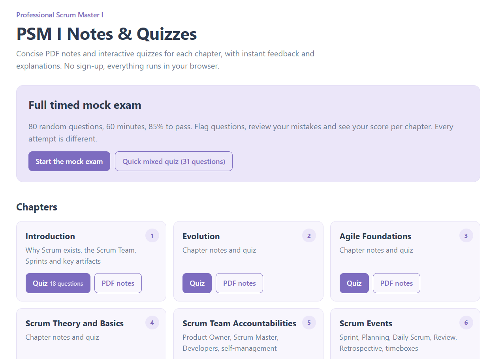

# PSM I Notes & Quizzes

Study notes and interactive quizzes for the **Professional Scrum Master I (PSM I)** certification. Each chapter has a concise PDF summary and a self-contained HTML quiz with instant feedback and explanations.

[](https://ajmions.github.io/psm1-notes-and-quizzes/)
[](#roadmap)

**Live site:** https://ajmions.github.io/psm1-notes-and-quizzes/

[](https://ajmions.github.io/psm1-notes-and-quizzes/)

> **Unofficial study material.** Not affiliated with or endorsed by Scrum.org. *Professional Scrum Master* and *PSM* are trademarks of Scrum.org.

---

## Table of contents

- [Quick start](#quick-start)
- [Chapters](#chapters)
- [Quiz features](#quiz-features)
- [Repository structure](#repository-structure)
- [Run locally](#run-locally)
- [Roadmap](#roadmap)
- [Disclaimer](#disclaimer)
- [Author](#author)

---

## Quick start

1. Pick a chapter in the [table below](#chapters).
2. Read the **PDF notes** (they open directly in GitHub).
3. Take the **quiz** (it opens in your browser, no install or sign-up).
4. Retry the questions you missed until you reach 100%.

> **Start here:** open the [live site](https://ajmions.github.io/psm1-notes-and-quizzes/) for the chapter index, or jump straight to the [full timed mock exam](https://ajmions.github.io/psm1-notes-and-quizzes/Quiz/PSM1_Full_Mock_Exam.html) or the [31-question mixed practice quiz](https://ajmions.github.io/psm1-notes-and-quizzes/Quiz/PSM1_09_Exam_Readiness_Quiz.html).

---

## Chapters

| # | Topic | Notes | Quiz | Questions |
|---|-------|-------|------|-----------|
| 1 | Introduction | [PDF](Course/PSM1_01_Introduction.pdf) | [Take quiz](https://ajmions.github.io/psm1-notes-and-quizzes/Quiz/PSM1_01_Introduction_Quiz.html) | 18 |
| 2 | Evolution | [PDF](Course/PSM1_02_Evolution.pdf) | [Take quiz](https://ajmions.github.io/psm1-notes-and-quizzes/Quiz/PSM1_02_Evolution_Quiz.html) | n/a |
| 3 | Agile Foundations | [PDF](Course/PSM1_03_Agile_Foundations.pdf) | [Take quiz](https://ajmions.github.io/psm1-notes-and-quizzes/Quiz/PSM1_03_Agile_Foundations_Quiz.html) | n/a |
| 4 | Scrum Theory and Basics | [PDF](Course/PSM1_04_Scrum_Theory_and_Basics.pdf) | [Take quiz](https://ajmions.github.io/psm1-notes-and-quizzes/Quiz/PSM1_04_Scrum_Theory_and_Basics_Quiz.html) | n/a |
| 5 | Scrum Team Accountabilities | [PDF](Course/PSM1_05_Scrum_Team_Accountabilities.pdf) | [Take quiz](https://ajmions.github.io/psm1-notes-and-quizzes/Quiz/PSM1_05_Scrum_Team_Accountabilities_Quiz.html) | 12 |
| 6 | Scrum Events | [PDF](Course/PSM1_06_Scrum_Events.pdf) | [Take quiz](https://ajmions.github.io/psm1-notes-and-quizzes/Quiz/PSM1_06_Scrum_Events_Quiz.html) | 21 |
| 7 | Scrum Artifacts | [PDF](Course/PSM1_07_Scrum_Artifacts.pdf) | [Take quiz](https://ajmions.github.io/psm1-notes-and-quizzes/Quiz/PSM1_07_Scrum_Artifacts_Quiz.html) | 21 |
| 8 | Scaling Scrum | [PDF](Course/PSM1_08_Scaling_Scrum.pdf) | [Take quiz](https://ajmions.github.io/psm1-notes-and-quizzes/Quiz/PSM1_08_Scaling_Scrum_Quiz.html) | 10 |
| 9 | Exam Readiness (tips, checklist) + practice quiz | [PDF](Course/PSM1_09_Exam_Readiness.pdf) | [Take quiz](https://ajmions.github.io/psm1-notes-and-quizzes/Quiz/PSM1_09_Exam_Readiness_Quiz.html) | 31 |
| 10 | Practical Guide #1: Serving the Scrum Team | [PDF](Course/PSM1_13_Practical_Guide_Scrum_Master.pdf) | [Take quiz](https://ajmions.github.io/psm1-notes-and-quizzes/Quiz/PSM1_10_Practical_Guide_Scrum_Master_Quiz.html) | 23 |
| 11 | Practical Guide #2: Serving the Product Owner | [PDF](Course/PSM1_11_Practical_Guide_Product_Owner.pdf) | [Take quiz](https://ajmions.github.io/psm1-notes-and-quizzes/Quiz/PSM1_11_Practical_Guide_Product_Owner_Quiz.html) | 24 |
| 12 | Important Terms in Scrum | [PDF](Course/PSM1_12_Important_Terms.pdf) | [Take quiz](https://ajmions.github.io/psm1-notes-and-quizzes/Quiz/PSM1_12_Important_Terms_Quiz.html) | 22 |

**Total: 12 chapters, plus the full mock exam below.**

### Full mock exam

[**Start the timed mock exam**](https://ajmions.github.io/psm1-notes-and-quizzes/Quiz/PSM1_Full_Mock_Exam.html) is modeled on the real PSM I format: **80 questions, 60 minutes, 85% to pass**.

- Draws 80 random questions from a pool of 151 unique questions across all chapters, so every attempt is different.
- Countdown timer with warnings at 10 and 2 minutes, and automatic submission when time runs out.
- Free navigation, answer changes and a **flag for review** option, as in the real assessment.
- Results with pass/fail, a per-chapter breakdown and an explanation for every missed question.
- All questions have a single correct answer. The real exam also includes multiple-answer and true/false questions.

### Topics at a glance

| Chapter | Key concepts |
|---------|--------------|
| 1 | Why Scrum exists, the Scrum Team, Sprints, key artifacts, purpose of Scrum |
| 2 to 4 | Evolution, Agile foundations, Scrum theory and basics (see the PDF notes) |
| 5 | Product Owner, Scrum Master, Developers, self-managing and cross-functional teams, servant leadership |
| 6 | Sprint, Sprint Planning, Daily Scrum, Sprint Review, Sprint Retrospective, timeboxes |
| 7 | Product Backlog, Sprint Backlog, Increment, Product Goal, Sprint Goal, Definition of Done |
| 8 | One Product Owner, one Product Backlog and one shared Definition of Done across teams |
| 9 | Preparation checklist, exam tactics, last-minute recap |
| 10 | Story points, velocity, planning poker, first days as a Scrum Master, defining success |
| 11 | Stakeholder management, product vision, Product Backlog items, refinement |
| 12 | Functional vs non-functional requirements, burndown chart, cone of uncertainty, Definition of Ready, technical debt |

---

## Quiz features

- **Instant feedback** with a short explanation for every answer.
- **Progress bar** and a results screen with a per-question review.
- **Retry missed questions** to focus on weak spots.
- **Light and dark mode**, following your system setting.
- **Keyboard accessible** with visible focus states.
- **Zero dependencies:** each quiz is a single HTML file that also works offline.

---

## Repository structure

```text
psm1-notes-and-quizzes/
├── index.html  # Landing page (site home on GitHub Pages)
├── assets/     # Images used in this README
├── Course/     # PDF study notes, one per chapter
├── Quiz/       # Interactive HTML quizzes and the full mock exam
└── README.md
```

File names follow the pattern `PSM1_<chapter>_<Topic>.pdf` and `PSM1_<chapter>_<Topic>_Quiz.html`.

---

## Run locally

No build step or dependencies are needed.

```bash
git clone https://github.com/AjmiOns/psm1-notes-and-quizzes.git
cd psm1-notes-and-quizzes
```

Open any file in `Quiz/` with a browser, for example by double-clicking it.

### Add a new quiz

Each chapter quiz is built from the same template. To create one for another chapter, copy an existing file from `Quiz/` and edit only:

1. the `<title>` and `<h1>`,
2. the `QUESTIONS` array, where each entry has `q` (the question), `options` (four choices), `answer` (the index of the correct option, starting at 0) and `why` (the explanation).

The mock exam has its own `POOL` array at the top of `Quiz/PSM1_Full_Mock_Exam.html`, with the keys `c` (chapter), `q`, `o` (options), `a` (answer index) and `w` (explanation).

---

## Roadmap

- [ ] Add notes and quizzes for the remaining chapters
- [x] Add an `index.html` landing page as the site's home
- [x] Add a full-length timed mock exam
- [ ] Add multiple-answer and true/false questions to the mock exam

---

## Disclaimer

These materials are personal study notes written for learning purposes. They are **unofficial** and may contain errors or simplifications. For the authoritative definition of the framework, always refer to the [Scrum Guide](https://scrumguides.org/) and the [Scrum.org PSM I](https://www.scrum.org/professional-scrum-master-i-certification) pages.

Issues and corrections are welcome: please open an [issue](https://github.com/AjmiOns/psm1-notes-and-quizzes/issues).

---

## Author

**Ajmi Ons**

Cloud Infrastructure Management Engineering student at TEK-UP University, Tunisia.

- 🐙 GitHub: [AjmiOns](https://github.com/AjmiOns)
- 💼 LinkedIn: [Ons Ajmi](https://www.linkedin.com/in/ons-ajmi--/)
